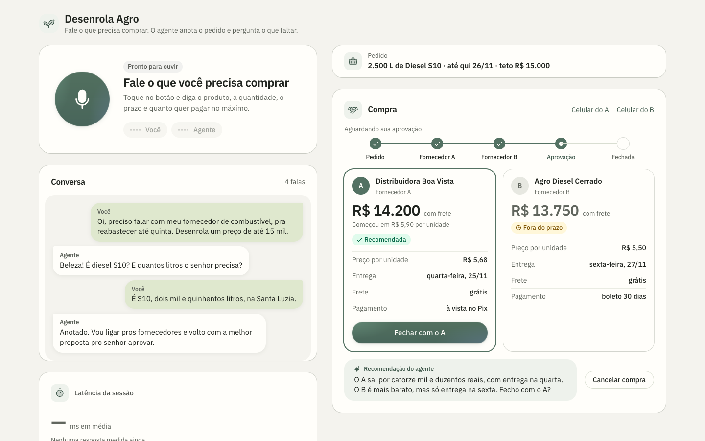
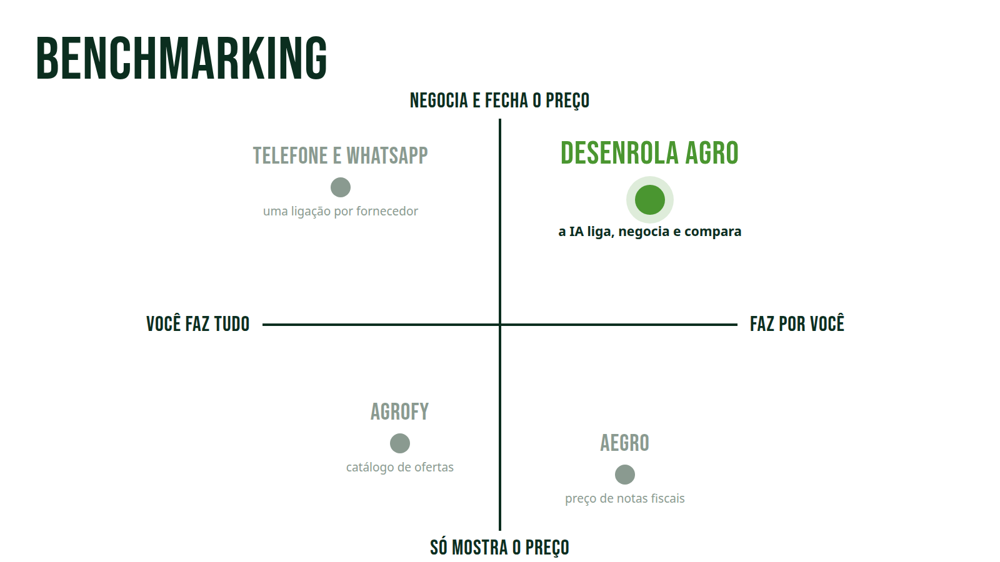

# Desenrola Agro

> "Oi, preciso falar com meu fornecedor de combustível, pra reabastecer até quinta. Desenrola um preço de até 15 mil."

É só isso que o produtor fala. O Desenrola Agro liga para os fornecedores, negocia dentro do limite que ele deu e volta com a melhor proposta para ele aprovar.

Projeto do hackathon **UNMUTE by Agora**, feito com o Agora Conversational AI Engine.

**🌱 Experimente agora: [desenrola.daviduarte.com.br](https://desenrola.daviduarte.com.br)**


---

## Sumário

1. [O problema](#o-problema)
2. [A solução](#a-solução)
3. [Como testar a demo](#como-testar-a-demo)
4. [Como usamos a Agora](#como-usamos-a-agora)
5. [O modelo conversa, o código garante](#o-modelo-conversa-o-código-garante)
6. [O que medimos](#o-que-medimos)
7. [Negócio](#negócio)
8. [Para onde isso vai](#para-onde-isso-vai)
9. [O que ainda não resolvemos](#o-que-ainda-não-resolvemos)
10. [Onde está cada coisa](#onde-está-cada-coisa)
11. [Stack e como rodar](#stack-e-como-rodar)

---

## O problema

Quem compra insumo no campo conhece a rotina: para cotar diesel, ração ou farelo, é preciso ligar para um fornecedor, depois para outro, esperar retorno e anotar preço, prazo e frete num papel. Numa cotação real de 15 mil litros de diesel em Feliz Natal (MT), foram **8 fornecedores consultados**.

E vale a pena ligar, porque o mesmo produto muda muito de preço dentro da mesma cidade:

| Insumo | Diferença entre fornecedores da mesma cidade | Fonte |
|---|---|---|
| Diesel S10 | **14%** em Sorriso/MT, no mesmo dia (R$ 7,09 a R$ 8,09/L). Mediana de 9% em 316 municípios | ANP, levantamento oficial |
| Farelo de soja | **16 a 24%** (Cuiabá/MT e Maringá/PR) | Anúncios ativos no MF Rural |

Quem não tem tempo de ligar para todo mundo paga a diferença. E isso pesa mais agora: a safra 2026/27 caminha para a **pior margem da soja em 10 anos** (Cepea), com margem líquida de 2,8% no médio-norte de MT.

No interior, essa conversa não vai virar formulário online tão cedo: o fornecedor resolve por telefone, e é assim que ele gosta. Pensamos no produtor de grãos de porte médio, que compra insumo com frequência e não tem um comprador dedicado. Ele está no campo, com as mãos ocupadas, e o telefone é o que tem à mão.

## A solução

O produtor fala o pedido como falaria com um funcionário. Se faltar alguma coisa, como a quantidade, o agente pergunta ("Quantos litros?") e depois confirma em voz alta, com os números por extenso.

Aí o agente liga para os fornecedores. Começa dizendo que é o assistente de inteligência artificial do produtor, pede o preço e tenta melhorar uma ou duas vezes: pelo volume, pelo pagamento à vista ou pelo frete. Se o fornecedor interrompe, ele para e escuta. Se o fornecedor pergunta "qual o máximo que ele paga?", ele não tem essa resposta, e explicamos o porquê logo abaixo.

Com as ofertas na mão, o sistema compara preço total, prazo, frete e pagamento, e descarta o que não chega a tempo. O agente volta ao produtor e recomenda: "O A sai por catorze mil e duzentos com entrega na quarta. O B é mais barato, mas só entrega na sexta. Fecho com o A?". **Nada é comprado sem o "fecha" dele.**

A voz aparece dos dois lados, e não por moda. O fornecedor continua atendendo o telefone como sempre, sem instalar nada. O produtor pede sem largar o trabalho. E negociar tem contraproposta, objeção e "me liga depois", coisas que um formulário ou um chatbot de texto não fazem bem.

| Tela do produtor: as duas ofertas e a recomendação | Celular do fornecedor tocando |
|---|---|
|  |  |

## Como testar a demo

1. Abra [desenrola.daviduarte.com.br](https://desenrola.daviduarte.com.br) no computador, de fone, e permita o microfone.
2. Toque no microfone e faça o pedido: *"Preciso de diesel S10 pra reabastecer até quinta, desenrola um preço de até 15 mil."* Responda o que o agente perguntar.
3. Use os botões **Celular do A** e **Celular do B**, no topo da tela, para abrir os celulares dos fornecedores. O ideal é que outra pessoa atenda cada um, num computador diferente, para não dar eco.
4. Quando o celular do A tocar, atenda e negocie como fornecedor. Quando a ligação termina, o celular do B toca sozinho.
5. O agente volta à tela do produtor com a recomendação. Diga "fecha", ou clique em **Fechar com o A**.

Na demo, os fornecedores são simulados por pessoas numa tela que imita o celular. Nenhuma empresa real é chamada.

## Como usamos a Agora

```
Produtor (navegador)                     Fornecedor A / B (navegador, tela de celular)
   │  voz em tempo real (Agora RTC)          │  voz em tempo real (Agora RTC)
   ▼                                          ▼
Agora Conversational AI Engine  (um agente para o produtor, um negociador por ligação)
   ouve ── Deepgram nova-3 (pt-BR)
   pensa ─ chama o nosso servidor ──▶ Nossas rotas de LLM (Next.js + Vercel AI SDK)
   fala ── Cartesia sonic-3.6, voz Alice (pt-BR)     tools, regras e estado ficam aqui
                                                     │
                                                     ▼
                                              Gateway de LLM da feita.ai
                                              (Gemini 3.5 Flash Lite)
```

A Agora cuida de tudo o que é voz: ouvir, perceber quando a pessoa terminou de falar, lidar com a interrupção, preencher a pausa com um "hum, deixa eu ver" quando o modelo demora e falar de volta. O raciocínio fica com a gente. A Agora chama as nossas rotas de LLM no formato de chat da OpenAI, com streaming, e é ali que rodam as tools, as regras de negócio e o estado da conversa.

## O modelo conversa, o código garante

A gente não confia num LLM para guardar segredo nem para fazer conta. Por isso, as regras que não podem falhar moram no código:

- **O negociador não sabe o teto.** Ele recebe só uma meta de preço. Quem compara a oferta com o teto do produtor é o código, depois da ligação. Não dá para vazar o que não está no contexto. Se o fornecedor pergunta o máximo, quem responde é o código: "Isso eu não tenho aqui, mas me passa o melhor preço do senhor que eu levo pra ele".
- **O código decide quando o pedido e a oferta estão completos.** Se falta a quantidade, a tool devolve o que falta e o agente pergunta. A ligação só termina quando há preço, prazo, frete e pagamento, ou quando o fornecedor disse que não atende.
- **Os números saem do código.** O total é calculado em código, e a confirmação falada ("dois mil litros, até quinze mil reais") também é montada em código. Isso deixou a resposta mais rápida, porque é uma chamada a menos ao LLM, e acabou com número errado na fala.
- **Cada frase passa por um filtro antes de virar voz.** O filtro corta "fechado", qualquer menção ao limite e despedidas antes da hora.
- **Só o produtor fecha.** O agente registra a oferta e, no máximo, diz "vou passar pro produtor e, se ele aprovar, eu retorno".

## O que medimos

Numa conversa simples, a resposta começa em média **1,54 s** depois que a pessoa para de falar. No fluxo completo, com o pedido virando tarefa e as ligações, a média ficou entre **1,8 e 2,0 s**.

| Teste | Resultado |
|---|---|
| Pedido falado virando a tarefa certa (texto) | 10 de 10 |
| Negociação com 7 tipos de fornecedor: desconto, resposta vaga, "qual o máximo?", sem estoque, apressado, hostil e acima do teto (texto) | 14 de 14, e o teto nunca apareceu na fala |
| Regras testadas sem LLM (comparação, fim da ligação, filtro) | 28 de 28 |
| Fluxo A → B → comparação → "fecha" | recomenda o fornecedor certo em todas as rodadas |
| Interrupção no meio da fala do agente | ele para e escuta |

Chegar nesses números deu trabalho. Começamos em 2,2 s. Testamos 8 LLMs (o Claude Haiku 5.5 escreve bem, mas passava de 2,8 s na voz) e 11 vozes em português. Trocamos o reconhecimento de fala, encurtamos a espera de fim de fala de 480 para 300 ms sem cortar ninguém e tiramos do LLM a fala da confirmação. Todas as rodadas, com data e número, estão em [`TESTES.md`](TESTES.md), e as gravações das vozes testadas estão em [`amostras/`](amostras).

## Negócio

O estudo completo, com todas as fontes, está em **[`docs/negocio/RELATORIO-ECONOMIA.md`](docs/negocio/RELATORIO-ECONOMIA.md)**. Aqui vai o resumo.

### Quem paga

A **cooperativa agrícola** paga **R$ 100 por mês por produtor ativo** (quem recebeu ao menos uma proposta válida no mês) e oferece o serviço aos cooperados. A proposta inclui uma garantia: no mês em que a economia medida de um produtor ficar abaixo de R$ 100, ele não é cobrado. Preço e critério de cobrança são hipóteses, ainda a validar com uma cooperativa.

Escolhemos a cooperativa porque ela já compra pelos cooperados, mede o benefício e é um canal de entrada para muitos produtores de uma vez. São **1.254 cooperativas agropecuárias** no Brasil, com R$ 487 bilhões em ingressos em 2025 (OCB).

### Por que compensa para o cooperado

Só no diesel, com uma compra de 2.000 litros por mês:

| Cenário | Economia por mês | Por ano | Vezes o preço |
|---|---|---|---|
| **Possibilidade:** fechar com o mais barato da cidade, em vez do preço médio | **R$ 550** | R$ 6.600 | 5,5× |
| **Conservador:** capturar só metade dessa diferença | **R$ 275** | R$ 3.300 | 2,75× |

Os R$ 550 saem da diferença mediana entre o preço médio e o posto mais barato de cada cidade, nos 316 municípios da ANP com 5 ou mais postos: R$ 0,275 por litro, ou cerca de 4%. Negociar baixa o preço de verdade: em pregões públicos de diesel, a negociação tirou de R$ 0,20 a R$ 0,52 por litro. Quem também compra farelo economiza mais **R$ 4.800 a R$ 7.200 por carga de 30 t**, ganho que não entra na conta acima.

Os detalhes estão em [`SPREAD-DIESEL-ANP.md`](docs/negocio/SPREAD-DIESEL-ANP.md) e [`SPREAD-FARELO-ANUNCIOS.md`](docs/negocio/SPREAD-FARELO-ANUNCIOS.md).

### Quanto custa entregar

No piloto, com 100 produtores ativos, o custo é de **R$ 70 por produtor por mês**. A IA (voz e APIs) é só R$ 15 disso. O resto é operação, suporte, hospedagem, comercial e tributos. A margem fica em **R$ 30 por produtor (30%)**, e o ponto de equilíbrio é de **62 produtores ativos**.

### Mercado e meta

| Recorte | Tamanho | Base |
|---|---:|---|
| TAM | 420.719 estabelecimentos | Brasil, de 100 a 1.000 ha (Censo Agro 2017) |
| SAM | 27.374 estabelecimentos | Mesmo recorte em Mato Grosso |
| SOM (meta do mês 12) | 100 produtores ativos | 2 cooperativas com 50 ativos cada |

A meta do mês 12 é **R$ 10 mil de receita por mês** (R$ 120 mil anualizados), com resultado operacional de R$ 3 mil por mês. Com 100 produtores, a cooperativa paga R$ 120 mil por ano, e os cooperados economizam de R$ 330 mil a R$ 660 mil só no diesel.

### Concorrência



O Aegro mostra preços de notas fiscais passadas. Na Agrofy, o produtor pede cotação num catálogo. Por telefone e WhatsApp, ele mesmo negocia, um fornecedor por vez. No Desenrola, ele delega a conversa, e a IA liga, negocia e compara por ele.

### Roadmap

| Quando | O quê |
|---|---|
| 0 a 3 meses, piloto | Diesel com 5 produtores de grãos de MT, numa cooperativa regional. Medir tempo poupado, propostas válidas e economia. |
| 3 a 6 meses | Ligação telefônica real, histórico de compras pela NF-e e alerta de reposição |
| 6 a 12 meses | Compra coletiva e outros insumos (farelo, fertilizante). Meta de 100 ativos em 2 cooperativas. |

## Para onde isso vai

**O agente liga antes de faltar.** Com o histórico de compras, dá para saber de quanto em quanto tempo cada produtor compra cada insumo. Quando o diesel estiver perto de acabar, quem liga é o agente: "Seu diesel deve acabar lá pelo dia 3. Quer que eu já cote dois mil litros?".

**Cadastro por voz, sem questionário.** Um número novo liga e o agente faz o cadastro conversando. Se a pessoa diz "tenho 300 cabeças", ele já sabe o tamanho da operação e que ela compra ração e feno, e não pergunta de novo.

**Compra coletiva.** Ligado a uma cooperativa, o agente junta os pedidos de vários produtores do mesmo insumo e negocia o volume total. Todo mundo paga menos.

**Histórico pela nota fiscal.** Toda compra de insumo gera uma NF-e num formato padrão que qualquer ERP exporta. Ler essas notas dá o histórico desde o primeiro dia, sem integrar com cada sistema.

**Ligação telefônica de verdade.** Na demo, o fornecedor atende numa tela que imita o celular. O próximo passo é ligar para um número real por SIP trunk, que a Agora já suporta.

## O que ainda não resolvemos

- Ainda não testamos com fornecedor de verdade. Na demo, quem atende é alguém do time.
- A economia de R$ 550 é uma premissa calculada sobre dado oficial, não uma medição. O levantamento da ANP mede o preço na bomba, e a compra a granel na fazenda não entra nele. A diferença do farelo vem de preços pedidos em anúncios, numa amostra pequena.
- O preço de R$ 100 e o custo de R$ 70 são de piloto e ainda precisam ser validados com uma cooperativa.
- Ligações automáticas em escala precisam seguir as regras da Anatel.
- A responsabilidade pela compra continua sendo do produtor, que aprova cada uma.
- O sinal de celular no campo é ruim.

## Onde está cada coisa

| O que | Onde |
|---|---|
| Demo no ar | [desenrola.daviduarte.com.br](https://desenrola.daviduarte.com.br) · QR code em [`docs/qrcode/`](docs/qrcode) |
| Estudo de negócio completo (economia, custos, mercado, fontes) | [`docs/negocio/RELATORIO-ECONOMIA.md`](docs/negocio/RELATORIO-ECONOMIA.md) |
| Diferença de preço do diesel entre postos (ANP) | [`docs/negocio/SPREAD-DIESEL-ANP.md`](docs/negocio/SPREAD-DIESEL-ANP.md) |
| Diferença de preço do farelo de soja (anúncios) | [`docs/negocio/SPREAD-FARELO-ANUNCIOS.md`](docs/negocio/SPREAD-FARELO-ANUNCIOS.md) |
| Como rodar, chaves, mapa do código e detalhes do negociador | [`docs/TECNICO.md`](docs/TECNICO.md) |
| Todas as medições e testes, com data | [`TESTES.md`](TESTES.md) |
| Gravações das vozes testadas e do "hum" | [`amostras/`](amostras) |
| Spec original do produto, usada para guiar os agentes de código | [`CLAUDE.md`](CLAUDE.md) |
| Código | `app/` (telas e rotas de API), `lib/` (regras: tarefa, negociação, comparação), `components/` (interface), `scripts/` (testes e deploy) |

## Stack e como rodar

Agora RTC e Agora Conversational AI Engine · Deepgram nova-3 (pt-BR) e Cartesia sonic-3.6, gerenciados pela Agora · Gemini 3.5 Flash Lite pelo gateway da feita.ai · Next.js e Vercel AI SDK, com as tools validadas em zod · deploy em Docker numa VPS.

Para rodar localmente, você precisa de Node 20 ou mais novo, do `cloudflared` e de contas na Agora e na feita.ai. O `ffmpeg` é opcional e só serve para os testes com áudio gravado.

```bash
npm install
cp .env.example .env.local   # preencha as chaves
npm run build && npm start
npm run tunel                # noutro terminal: a Agora precisa alcançar o servidor pela internet
```

O passo a passo completo, com as chaves e os scripts de teste, está em [`docs/TECNICO.md`](docs/TECNICO.md).
